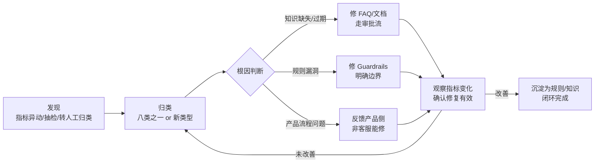

# 02 Badcase 发现与处理

> 本文档呈现 badcase 的**类型学框架 + 发现机制 + 处理闭环**。由于已离职、后台会话无法回溯，本文不放入具体会话存档，改用**场景化心得**：以一个示意场景讲清"为什么不要一味追求自动解决率"，并落到用户分层与信任的洞察上。示意场景仅用于说明设计逻辑，非真实会话记录。

## 一、Badcase 从哪来：三个发现通道

| 通道 | 机制 | 捕捉什么 |
|---|---|---|
| 指标异动 | 监控自动解决率、转人工率、重开率、每对话消息数，异常波动触发下钻 | 系统性规则缺陷 |
| 会话抽检 | 定期抽查转人工会话，重点看"客户重复表达""情绪升级""答非所问" | 单条回答质量、知识缺口 |
| 转人工原因归类 | 对转人工会话按原因归类统计（规则内升级 vs 规则外逃逸） | 该转的转得干不干净、不该转的为什么转 |

**核心观点：badcase 不是一个 bug，是一类 bug。** 单条坏回答修掉就没了；把坏回答归类成模式，才知道该修规则、修知识、还是修流程。

## 二、八类 badcase 与规则应对

以下类型由实际生效的 Guardrails 规则反向整理——**每条规则背后都对应一类必须拦住的回答失败**：

| # | badcase 类型 | 典型表现 | 根因 | 规则应对 |
|---|---|---|---|---|
| 1 | 越权判断 | 对退款资格、责任归属、赔付金额给出肯定答复 | 智能体没有个案判断权限，但 LLM 天然倾向"给答案" | 场景识别 → 强制转人工（规则 #3） |
| 2 | 虚假回执 | 说"已为您转人工/已退款/已提交"但动作并未发生 | 把生成的话当发生的事 | 回执校验：无真实回执不得声称执行（规则 #5） |
| 3 | 状态误报 | 把"已提交"说成"已完成/已解决" | 混淆业务流程节点 | 核对动作、状态、时间、回执标识四要素（规则 #6） |
| 4 | 循环追问 | 客户已留言未获回复，机器人再次要求"请留言" | 只认流程不认上下文 | 利用已有信息转人工，禁止重复索取（规则 #4） |
| 5 | 过早关单 | 客户沉默即视为解决并关单 | 把"没有回应"当"满意" | 沉默≠解决，风险未决不关单（规则 #8） |
| 6 | 版本择优 | 政策文件冲突时选了更新但未批准的宽松版本 | 把时间新近性当有效性 | 只用已批准内容，有效性≠新近性（规则 #2） |
| 7 | 过度收集 | 简单流程问题也索要订单截图等个案材料 | 防御性提问过重 | 一般咨询直接答，最小化收集（规则 #1、#9） |
| 8 | 升级迟滞 | 客户明确要求人工，机器人还在按流程要资料 | 升级触发条件缺失或优先级低 | 满足升级条件直接转人工（规则 #7） |

## 三、场景化心得：为什么不要一味追求自动解决率

### 一个示意场景

一位代发人（供给侧用户）对一笔"重复扣费"提出质疑，情绪明显。

如果系统只盯"自动解决率"这一个 KPI，机器人最可能的表现是这样的：

> 给出一段标准退款政策说明 → 附一句"您的问题已记录，我们会跟进"→ 关单。

在面板上，这会被记一次"自动解决"。指标好看了。

但客户真正要的，根本不是一段政策复读，而是**"这笔钱到底回不回、什么时候回、谁来负责"的确定性**。这是一笔涉及钱的、带情绪的、需要被真人接住的问题。把它"解决"掉，解决的是机器人的指标，不是客户的问题。

规则 #3（不自行判断个案资金，转人工核查）和规则 #8（风险未决、客户沉默不关单）正是为这类场景设的：**宁可让自动解决率少涨一点，也要把人接住。** 在信任成本高的场景里，快速转人工本身就是一种"正确且高质量的自动行为"。

### 核心观点：用户分层之后，要分清"要答案"还是"要信任"

把客户分层（角色、问题风险、状态，见 04 文档）往后推一步，会碰到一个更本质的区分：

| 客户真正要的 | 典型场景 | AI 该怎么做 |
|---|---|---|
| **答案**（配置/流程类，低信任成本） | 资源能否当天发布、链接怎么带 tracking、发票怎么开 | 直接答、给入口，自动解决率越高越好 |
| **信任**（权益/资金/情绪类，高信任成本） | 重复扣费、退款资格、投诉、明确要人工 | 快速见人，转人工率高是正确形态 |

用同一把"自动解决率"的尺子量这两类，会逼着机器人去"解决"它本该交付给人的信任问题。**冲解决率的结果，往往是把信任问题伪造成已解决——指标涨了，信任掉了。**

所以我的判断是：**AI 客服的 KPI 不该是"解决率最大化"，而该是"对的问题交给对的人"。** 落到指标上，健康的形态应该是：

- 配置/流程类场景：自动解决率高、转人工率低；
- 权益/资金/情绪类场景：自动解决率低、转人工率高，且重开率稳定、每对话消息数不飙升。

**反过来，如果高信任场景也出现高自动解决率，那才是要警惕的信号**——意味着有人在用"关单"掩盖"没解决"（详见 05 文档"指标连着看"）。

> **实证补充（两个真实案例，见 [06 文档](06_流程优化案例.md)）**：这套判断不是事后总结的方法论，是在业务里真摔出来的。
>
> - **案例 A**：把"首次用户 + 五类具体细化问题"从 AI 自动解答改判为转人工，自动解决率被主动牺牲，换来新用户当月注册转化率约 20% → 约 30%。
> - **案例 B**：一段只讲责任边界的统一话术让自助解决率上升，同批用户流失率却达到约 50%——**对话指标向好、业务结果恶化**，这是"只盯解决率"最典型的代价。

### 这段心得对面试的价值

它把"我做了九条规则"升级成了"我知道为什么这么定"：

- 不是"为了安全才转人工"，而是"信任问题交给人，是分层运营的结论，不是保守"；
- 不是"我没把解决率做高"，而是"我有意识不把它做高，因为那会伤害真正重要的东西"；
- 呼应 JD 里"关注解决率与满意度"——我的理解是，**解决率和满意度是两条线，满意度才是终点，解决率只是手段之一，且只在低风险场景该被最大化**。

## 四、badcase 处理闭环

## 五、心得（面试讲这段的重点）

1. **修 badcase 的第一问不是"怎么改回答"，是"这是谁的问题"。** 知识问题修知识，规则问题修规则，产品问题推给产品——修错层，同一类 badcase 会反复回来。
2. **LLM 的默认性格是"有问必答"，这恰恰是客服场景最大的风险源。** 所以我的规则设计里，"不许答什么"比"怎么答"占的篇幅更大。
3. **判断修复有效要看指标，但只看自动解决率会骗人。** 转人工率下降如果伴随重开率上升，说明是把问题推出去了，不是解决了。所以四项指标必须连着看（详见 05 文档）。
