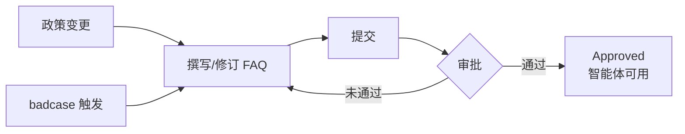

# 03 知识库分类体系

> 当前规模：1,157 条已批准 FAQ + 108 份业务文档，由我独立撰写并持续维护。数量为累计资产，非新增统计。

## 一、FAQ 的四大场景分类

FAQ 不按产品功能组织，按**客户来问的事情**组织——用户不会按系统模块提问，他们问的是"我的事"：

| 场景分类 | 覆盖问题示例 | 特点 |
|---|---|---|
| 发布条件类 | 资源能否当天发布；帖子等待审核或上帖如何联系代发人 | 时效敏感，答案需给可执行动作 + 承诺边界 |
| 订单进度类 | 充值、推广订单、发票相关咨询 | 涉及资金，是规则层重点看护区域 |
| 平台操作类 | 带 tracking 参数或联盟标识的链接如何处理 | 步骤型内容，需给操作入口 |
| 服务规则类 | 折扣能否使用优惠券、是否需在商品前台展示 | 政策型内容，最易出现版本冲突 |

每条标准答案的结构：**标准答复 + 操作入口 + 适用条件**。例如"能否当天发布"：给上帖用时筛选方式、代发描述及留言入口，同时说明实际发布仍受选帖和排期影响——既给动作，也不做超范围承诺。

## 二、文档体系：文档挂 FAQ 的两级结构

108 份业务文档承载政策原文与流程说明，每份文档关联若干 FAQ：

| 文档示例 | 关联内容 |
|---|---|
| 隐私协议 | 相关合规类 FAQ |
| 站外搜索 | 链接处理类 FAQ |
| 黑名单 | 服务规则类 FAQ |
| 售后申请 | 订单进度与资金类 FAQ |
| 折扣修改 | 服务规则类 FAQ |
| 联系代发人 | 发布条件类 FAQ |

两级结构的价值：
- **文档是"法条"，FAQ 是"判例"。** 文档保证政策有原文可依，FAQ 把政策翻译成客户问法。
- **文档-FAQ 关联让更新有传导路径。** 政策改了，沿关联关系能找到所有受影响的 FAQ，不会漏改。

## 三、标注与质检：Approved 审批流

知识条目有明确的审批状态流转，"Approved" 是进入智能体可用范围的唯一准入状态：

这套流程同时就是**训练数据的标注及质检规则**：
1. **准入质检**：只有 Approved 条目可被引用，从源头杜绝未确认内容。
2. **有效性管理**：批准状态与发布时间分离——新文件不自动生效，旧文件不自动失效（对应规则 #2 的知识侧配套）。
3. **触发更新**：政策变更和 badcase 是知识修订的两大触发源，修订后重新走审批。

> 口径注意：后台显示"100% approved"指展示范围内条目的审批状态，**不等于回答正确率 100%，也不等于覆盖所有客户问题**。

## 四、知识组织的三个设计判断

1. **按客户问题组织，不按组织架构组织。** 分类的检验标准是：客户用自然语言提问时，能否被召回。
2. **知识库是活的资产，不是一次性工程。** 1,157 条 FAQ 是 2025 年上线以来持续运营的累计结果，每次政策变更和 badcase 修复都会回流到这里。
3. **独立撰写是质量底线。** 知识内容由我独立撰写——保证口径统一，也保证我对每条知识能否被信任负全责。
