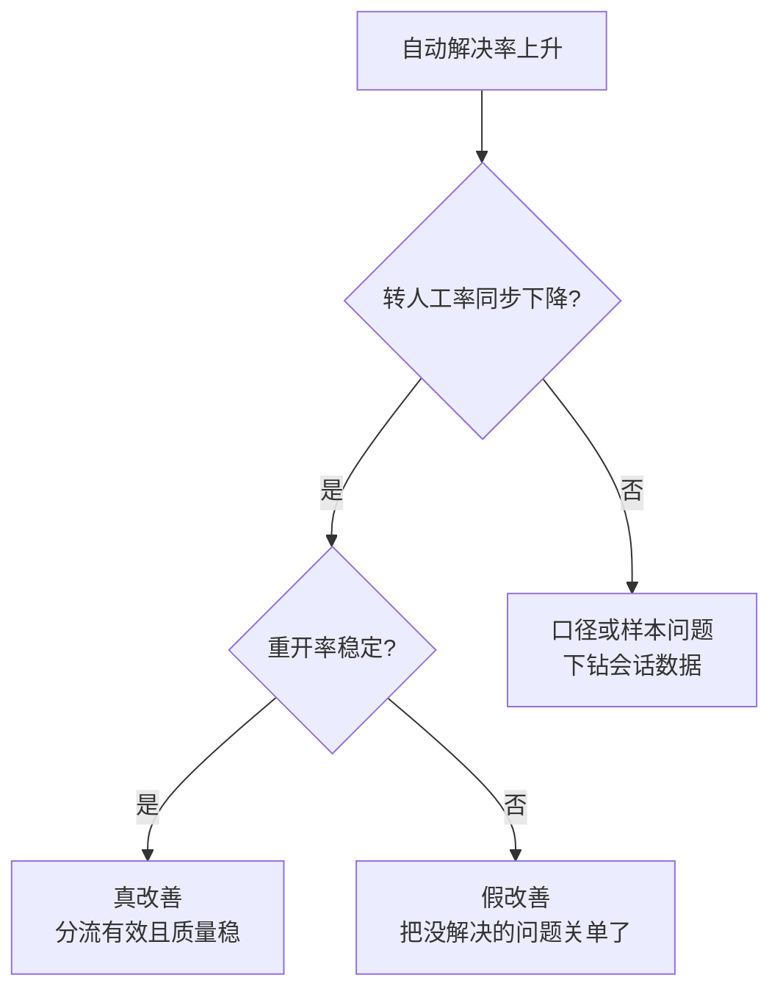

# 05 关键指标体系：我重点看哪些数据

## 一、六个核心指标与关注理由

| 指标 | 我为什么盯它 | 看什么 |
|---|---|---|
| **自动解决率** | AI 客服的核心产出指标，直接对应"分流重复咨询"的项目目标 | 水平 + 趋势；结构上更关心"解决的是什么类型"——靠规则拦住的解决和靠知识答对的解决，质量不同 |
| **转人工率** | 自动解决率的镜像，但**不是越低越好** | 转出去的是不是该转的（争议、投诉）——该转的快速转是正确行为；不该转的转了才是问题 |
| **重新打开率** | 服务质量的"后悔药"指标 | 重开 = 上一轮没真正解决。这是发现"虚假解决"最灵敏的信号 |
| **平均每对话消息数** | 效率与体验的复合指标 | 消息数暴涨通常意味着机器人在绕圈子（循环追问类 badcase 的典型特征） |
| **处理对话量** | 分母指标，判断其他比率是否失真 | 样本太小时比率波动无意义，先看量再解读率 |
| **节省人工时间** | 向业务翻译 AI 价值的桥梁指标 | 平台估算值，用于业务沟通，不用于精确考核 |

## 二、指标必须连着看：单指标会骗人

**一个真实的判断例子**：自动解决率 +22.5 个百分点、转人工率 −19.6 个百分点，如果只看这两个数会很兴奋；但必须同时确认重开率维持 0%、每对话消息数下降——四项一起看，才能说这轮改善是真的把问题消化了，而不是把问题藏住了。

## 三、当前数据面板（近 7 天窗口）

| 指标 | 当前值 | 变化 |
|---|---|---|
| 处理对话数 | 109 起 | +6.9% |
| 自动解决率 | 29.4% | +22.5 pts |
| 转人工率 | 70.6% | −19.6 pts |
| 重新打开率 | 0% | — |
| 每对话消息数 | 2.6 | −0.6 |
| 节省人工时间 | 10 小时（平台估算） | — |

> 口径声明：面板窗口数据，非上线以来累计；变化值为面板对比期差值，不能直接归因为某一次配置修改。对话量级下（周百余起），小幅波动不构成趋势判断依据。

## 四、指标如何触发迭代

指标不是汇报用的，是**迭代触发器**：

| 信号 | 触发动作 |
|---|---|
| 转人工率异常升高 | 下钻转人工原因归类 → 知识缺口 or 产品问题 or 规则过严 |
| 重开率 > 0 | 逐条检查重开会话 → 判定"虚假解决"类型 → 修关单规则 |
| 消息数上升 | 抽查长对话 → 通常命中循环追问或答非所问 → 修上下文利用规则（规则 #4、#9） |
| 政策变更通知 | 主动触发文档与关联 FAQ 的传导修订，不等 badcase 教训 |

## 五、指标体系的缺口与规划（诚实边界）

1. **缺满意度指标**。当前用重开率、抽检间接代理客户主观感受，计划推动满意度评价采集（对话结束后单题评价）。
2. **缺业务结果指标与对话指标的打通——这是最重要的一条缺口。** 案例 B（见 [06 文档](06_流程优化案例.md)）里出现过最典型的反例：一段统一话术让**自助解决率上升**、同批用户**流失率却约 50%**。对话指标只会告诉你"对话结束得干不干净"，不告诉你"人还在不在"。理想状态是把复投率/留存这类业务结果指标接到同一张表里，与解决率、转人工率一起看。
3. **缺转人工原因的结构化归类面板**。目前靠人工归类，样本大后需要系统化。
4. **缺分层视图**。指标目前是全量口径，理想状态是按客户角色（供给侧/需求侧）拆分看，与客户分层策略对齐（见 04 文档）。
