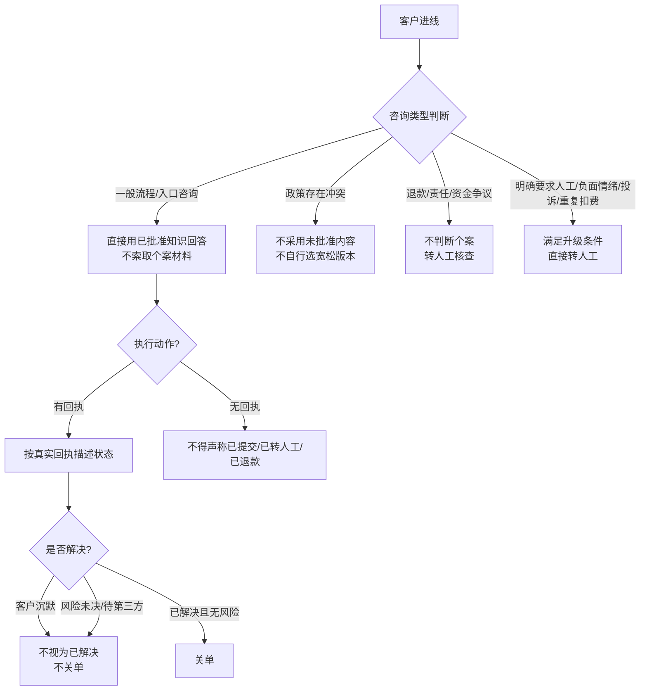

# 01 客服处理流程与规则设计

## 设计起点：先画"谁能决定什么"，再写规则

AI 客服最常见的失败不是"答不上来"，而是**答了问题对应不上的**。所以在写任何回答规则之前，我先梳理了平台上四类角色的权限边界：

| 角色 | 能决定的事 | 不能决定的事 |
|---|---|---|
| 智能体 | 解释规则、给操作入口、查询进度类回复 | 个案资金判断、责任认定、承诺执行结果 |
| 人工客服 | 个案核查、退款资格与金额、投诉处理 | — |
| 代发人（供给侧用户） | 发布资源、接单、履约 | 平台规则修改 |
| 平台/编辑 | 帖子审核、规则制定、黑名单管理 | — |

这个表决定了后面所有规则的底层逻辑：**智能体的回答边界 = 它真正被授权的范围**，超出即转人工。

## 分层处理架构

所有进线咨询按"场景 + 风险"两层判断，走不同处理通道：

## 九类 Guardrails 场景规则全表

这是本项目的核心资产。每条规则对应一类真实业务风险：

| # | 场景 | 规则设计 | 拦住的风险 |
|---|---|---|---|
| 1 | 一般入口及流程咨询 | 使用已批准且有效的知识直接回答，不必索取个案材料 | 简单问题被过度追问，用户体验差 |
| 2 | 政策存在冲突 | 不因文件较新就采用未批准内容，不自行选择更宽松版本 | 把"新"当"有效"，越权解释政策 |
| 3 | 退款、责任或资金争议 | 不自行判断个案退款资格、责任、金额，需人工核查 | 智能体越权做资金承诺 |
| 4 | 客户留言后未获回复 | 不重复要求留言，利用已有信息转人工 | 客户在同一操作里反复循环 |
| 5 | 操作没有成功回执 | 不能声称已转人工、已退款、已取消或已提交成功 | 虚假回执，制造"已解决"假象 |
| 6 | 提交与完成 | submitted 只代表提交；核对动作、状态、时间及回执标识 | 把"已提交"当"已完成"误报 |
| 7 | 明确要求人工、投诉或重复扣费 | 满足升级条件直接进入人工，不等无关资料补齐 | 升级迟滞，激化客户情绪 |
| 8 | 判断是否解决 | 客户沉默不代表已解决；风险未决、待人工或第三方不关单 | 过早关单导致问题丢失 |
| 9 | 收集信息 | 优先使用客户已提供内容，仅补充当前回答确需的信息 | 重复询问，交接信息丢失 |

## 设计原则（面试可直接讲的三条）

1. **"能说"和"能做"分开。** 回答基于已批准知识；执行动作必须以真实回执为据。没有回执，宁可说"正在处理"，不能说"已处理完成"。
2. **"自动"和"升级"有明确触发条件。** 不是越多自动解决越好——资金争议、重复投诉这类场景，快速转人工才是正确的自动行为。
3. **关单是最保守动作。** 客户沉默、风险未决、依赖第三方处理，都不关单。关单错了的代价（问题丢失、客户二次进线）远大于多挂一会儿。

## 与平台业务的对应关系

- 帖子审核与上帖时效 → FAQ 场景"资源能否当天发布"：回答同时给出可执行动作（上帖用时筛选、留言入口）与承诺边界（实际发布受选帖和排期影响）。
- 订单与支付流程 → FAQ 覆盖充值、推广订单、发票咨询；规则层设置资金争议转人工。
- 服务责任划分 → 规则层第 3、5、6 条直接来自"平台、代发人、编辑分别能决定什么"的权限表。

---

> 证据状态说明：规则内容来自智能体后台 Guardrails 配置页，为实际生效配置；作品集按当前可验证状态呈现。
